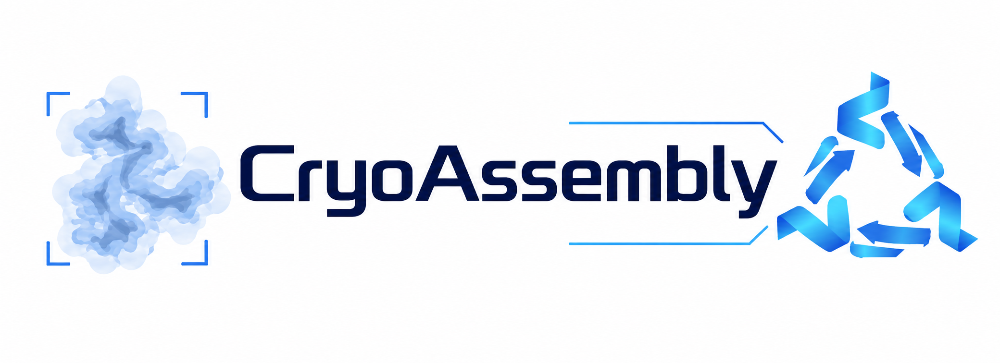

<div align="center">

<p align="center">
  
</p>

**Protein structure assembly from cryo-EM and cryo-ET maps through geometric correspondence learning**


[](LICENSE)

<!--
[**Open the CryoAssembly web server ↗**](http://zhouxglab.com/CryoAssembly/)
-->

**English** · [简体中文](README.zh-CN.md)

<!-- [Web server](#web-server) · -->

[Installation](#installation) · [Usage](#usage) · [Method](#method) · [FAQ](#faq) · [Citation](#citation) · [License](#license)

</div>

## Overview

CryoAssembly fits and assembles input protein structures into cryo-electron microscopy (cryo-EM) and cryo-electron tomography (cryo-ET) density maps. It combines deep feature-based structure-to-map registration with hierarchical chain- and domain-level assembly to produce a protein complex model in mmCIF format.

**CryoPARE-Net** learns geometric correspondences between structure-derived and map-derived point clouds to estimate fitting poses. Density-guided local optimization and domain-level assembly then position the input components within the map. Input structures can be predicted or experimentally determined.

| Input | Output |
| :--- | :--- |
| Density map, protein structure models, resolution and contour level | Assembled complex models (`.cif`) and an assembly summary |

<!--
<a id="web-server"></a>

## Web server

Submit your density map and protein structures through the [**CryoAssembly web server**](http://zhouxglab.com/CryoAssembly/), or use the [local installation](#installation) below.
-->

<a id="installation"></a>

## Installation

Use **Linux x86_64**, an NVIDIA GPU, Conda and a compatible C/C++ compiler. The verified installation baseline is Ubuntu 20.04, GCC/G++ 9.4 and CUDA 11.3.

Tested on **NVIDIA A800 80GB PCIe**. The verified installation and runtime checks used a **MIG 1g.10gb** instance (9728 MiB available).

Get the source from the [official GitHub repository](https://github.com/zhouBiolab/CryoAssembly):

```bash
git clone --branch main --single-branch https://github.com/zhouBiolab/CryoAssembly.git
cd CryoAssembly
```

<details>
<summary><strong>Downloaded from GitHub instead of cloning?</strong></summary>

On the [official repository page](https://github.com/zhouBiolab/CryoAssembly), select **Code → Download ZIP** and extract the archive. The project folder is normally named `CryoAssembly-main`:

```bash
cd CryoAssembly-main
```

Enter the directory containing `install.sh`, `requirements.txt` and `main.py`. If your extraction tool creates an additional outer folder, enter the inner project folder. The folder name can differ; the installer locates the project from its own path.

</details>

From that project directory, install and activate the environment:

```bash
bash install.sh
conda activate cryoassembly
```

The installer creates a separate `cryoassembly` environment, installs the pinned dependencies and builds the bundled `pareconv` and `pointops` extensions. `requirements.txt` is the single Python dependency definition.

<details>
<summary><strong>System requirements and verified environment</strong></summary>

The installer requires an NVIDIA driver compatible with CUDA 11.3, build tools, `libGL.so.1` and `libgomp.so.1`. On Ubuntu 20.04, install missing system packages before running it:

```bash
sudo apt-get install build-essential libgl1 libgomp1
```

| Component | Verified baseline |
| :--- | :--- |
| Operating system | Ubuntu 20.04.6, Linux x86_64 |
| Compiler | GCC/G++ 9.4.0 |
| GPU | NVIDIA A800 80GB PCIe; MIG 1g.10gb instance |
| Python | 3.8.20 |
| PyTorch | 1.10.0+cu113 |
| CUDA toolkit / nvcc | 11.3.1 / 11.3.122 |
| NumPy / Numba / llvmlite | 1.21.5 / 0.56.4 / 0.39.1 |
| SciPy / Biopython / Open3D | 1.10.1 / 1.79 / 0.14.1 |

The installer obtains PyTorch from the official cu113 index and checks package versions, extensions and imports.

</details>

<details>
<summary><strong>Environment selection and installation checks</strong></summary>

```bash
bash install.sh myenv                  # create a new environment
bash install.sh myenv --skip-env       # install dependencies and rebuild in an existing environment
bash install.sh myenv --verify-only    # check an existing installation without installing or building
bash install.sh --help
```

Use a new environment name, or select `--skip-env` for an existing environment with Python 3.8.20 and the CUDA 11.3 toolkit. `--verify-only` checks dependencies, imports and operators.

`CONDA_BASE` selects the Conda installation. `MAX_JOBS` sets build workers (default 8). `PIP_INDEX_URL` and `PIP_FIND_LINKS` select a Python package mirror or wheel cache.

</details>

<details>
<summary><strong>Official dependency downloads</strong></summary>

`bash install.sh` downloads and installs dependencies automatically. These official links are available for manual downloads. For Python wheels, choose **Linux x86_64 / CPython 3.8**; versions are defined by [requirements.txt](requirements.txt) and [environment.yml](environment.yml).

- [Miniconda official installers](https://repo.anaconda.com/miniconda/).
- [Python Conda packages](https://anaconda.org/conda-forge/python/files): select version **3.8.20** and platform **linux-64**.
- [NVIDIA CUDA toolkit packages](https://anaconda.org/nvidia/cuda-toolkit/files): select **11.3.1** in the **cuda-11.3.1** label.
- [NVIDIA nvcc packages](https://anaconda.org/nvidia/cuda-nvcc/files): select **11.3.122** in the same label.
- [PyTorch official cu113 index](https://download.pytorch.org/whl/cu113/torch/).

| Package | Version | Official download |
| :--- | :--- | :--- |
| `torch` | 1.10.0+cu113 | [Linux / CPython 3.8 wheel](https://download-r2.pytorch.org/whl/cu113/torch-1.10.0%2Bcu113-cp38-cp38-linux_x86_64.whl) |
| `numpy` | 1.21.5 | [PyPI files](https://pypi.org/project/numpy/1.21.5/#files) |
| `scipy` | 1.10.1 | [PyPI files](https://pypi.org/project/scipy/1.10.1/#files) |
| `numba` | 0.56.4 | [PyPI files](https://pypi.org/project/numba/0.56.4/#files) |
| `llvmlite` | 0.39.1 | [PyPI files](https://pypi.org/project/llvmlite/0.39.1/#files) |
| `scikit-learn` | 1.3.2 | [PyPI files](https://pypi.org/project/scikit-learn/1.3.2/#files) |
| `biopython` | 1.79 | [PyPI files](https://pypi.org/project/biopython/1.79/#files) |
| `mrcfile` | 1.5.3 | [PyPI files](https://pypi.org/project/mrcfile/1.5.3/#files) |
| `open3d` | 0.14.1 | [PyPI files](https://pypi.org/project/open3d/0.14.1/#files) |
| `easydict` | 1.13 | [PyPI files](https://pypi.org/project/easydict/1.13/#files) |
| `tqdm` | 4.65.0 | [PyPI files](https://pypi.org/project/tqdm/4.65.0/#files) |
| `threadpoolctl` | 3.5.0 | [PyPI files](https://pypi.org/project/threadpoolctl/3.5.0/#files) |
| `einops` | 0.6.1 | [PyPI files](https://pypi.org/project/einops/0.6.1/#files) |
| `ipdb` | 0.13.13 | [PyPI files](https://pypi.org/project/ipdb/0.13.13/#files) |
| `ipython` | 8.12.3 | [PyPI files](https://pypi.org/project/ipython/8.12.3/#files) |
| `ninja` | 1.11.1.4 | [PyPI files](https://pypi.org/project/ninja/1.11.1.4/#files) |
| `pip` | 24.3.1 | [PyPI files](https://pypi.org/project/pip/24.3.1/#files) |
| `setuptools` | 69.5.1 | [PyPI files](https://pypi.org/project/setuptools/69.5.1/#files) |
| `wheel` | 0.45.1 | [PyPI files](https://pypi.org/project/wheel/0.45.1/#files) |

</details>

<a id="usage"></a>

## Usage

### Prepare the inputs

Create a directory containing your map and protein structures:

```text
data_dir/
├── map.mrc
├── model_A.pdb
├── model_B.cif
├── resolution.txt
└── contour_level.txt
```

`resolution.txt` contains the resolution in ångströms; `contour_level.txt` contains the map contour level. Chain identifiers are read from the structure contents.

### Run the assembly

From the repository directory, with `cryoassembly` activated:

```bash
python main.py data_dir --log
```

Keep domain splitting enabled. **For structure files containing multiple chains, add `--complex-domain-opt`.**

### Locate the results

The default output directory is beside the input map. The main result files are:

```text
data_dir/output/assembly/final_results/
├── assembled_complex.cif
├── assembled_complex_all.cif
├── refined_complex.cif          # when refinement produces a result
└── assembly_summary.txt
```

`assembled_complex.cif` is the filtered assembly, `assembled_complex_all.cif` contains all accepted components, and `refined_complex.cif` is the refinement result when generated.

<details>
<summary><strong>Manual input and an explicit output directory</strong></summary>

Manual mode accepts `.mrc` or `.map`; automatic directory mode discovers `.mrc` only. Specify the map, structure directory, resolution, contour level and optional output directory:

```bash
python main.py data_dir/map.mrc data_dir 5.6 0.04 result --log
```

Replace `5.6` and `0.04` with your map's resolution and contour level. Results are saved under `result/assembly/final_results/`.

</details>

<details>
<summary><strong>Multi-chain inputs and refinement options</strong></summary>

For a template containing multiple chains:

```bash
python main.py data_dir --complex-domain-opt --log
```

Homologous-domain refinement is enabled by default. Add `--homo-chain-refine` for the optional subsequent homologous-chain refinement stage:

```bash
python main.py data_dir --complex-domain-opt --homo-chain-refine --log
```

Use `--no-refine` to disable homologous-domain refinement.

</details>

<details>
<summary><strong>Parameters and memory controls</strong></summary>

| Option | Default | Meaning |
| :--- | :---: | :--- |
| `--chain-threshold` | 0.45 | Chain-fitting early-stop and pre-screen threshold |
| `--domain-threshold` | 0.45 | Initial independent-domain threshold |
| `--complex-threshold` | 0.35 | Multi-chain template early-stop and pre-screen threshold |
| `--domain-min-cc` | 0.35 | Domain-threshold adaptation floor |
| `--complex-min-cc` | 0.25 | Final domain-level output filter |
| `--num-processes` | 8 | Shared CPU process-pool size for scoring and local optimization |
| `--batch-size` | 5 | Candidates accumulated per evaluation batch |
| `--mask-radius-factor` | 1.35 | Mask radius relative to the source radius of gyration. Smaller masks reduce GPU memory per fit but require more fitting attempts |
| `--min-point-distance-factor` | 0.32 | Mask-center spacing factor relative to the mask radius |
| `--hypothesis-chunk` | 64 | Hypotheses scored per block to bound inference memory |

The effective hypothesis-chunk default is 64. A CLI value overrides `--runtime-config`; `0` disables hypothesis chunks while retaining query tiling.

Use `python main.py --help` for all options.

</details>

<a id="method"></a>

## Method

1. **Represent structures and maps as point clouds.** Voxelization, sampling and sliding map masks prepare local structure-to-map registration pairs.
2. **Estimate fitting poses with CryoPARE-Net.** Learned geometric features establish correspondences and support rigid-pose estimation, followed by density-guided local optimization.
3. **Assemble through chains and domains.** Chain-level fitting provides candidate poses for domain processing. Remaining domains are fitted independently, and occupied density is masked as domains are accepted.
4. **Merge and refine.** Accepted domains are assembled into chains and a complex; homologous-domain pose reassignment uses connectivity information. Output filtering and optional refinement provide the final models.


<a id="faq"></a>

## FAQ

<details>
<summary><strong>How should I choose the contour level?</strong></summary>

Start with the map's recommended contour level and inspect the retained density. This value controls the region sampled into the target point cloud.

</details>

<details>
<summary><strong>What if GPU memory is insufficient?</strong></summary>

Reduce `--mask-radius-factor` to use smaller map regions, or use a smaller positive `--hypothesis-chunk` to score fewer hypotheses at once. `--num-processes` controls CPU workers.

</details>

<a id="citation"></a>

## Citation

Associated manuscript: **Accurate protein structure assembly from cryo-EM and cryo-ET maps through geometric correspondence learning**.

<a id="license"></a>

## License

Copyright (c) 2026 CryoAssembly contributors. Original CryoAssembly contributions are licensed under **LGPL-3.0-only**. See [LICENSE](LICENSE) and the incorporated [GPL v3 terms](licenses/GPL-3.0.txt). Third-party components retain their own licenses and notices.

## Acknowledgements

We thank the authors of [PARE-Net](https://github.com/yaorz97/PARENet), [GeoTransformer](https://github.com/qinzheng93/GeoTransformer) and [UGP](https://github.com/peakpang/UGP) for the registration methods, components and design ideas that informed CryoPARE-Net.

The assembly pipeline also uses **US-align** for structural alignment, [**CryoAlign**](https://github.com/HeracleBT/CryoAlign)'s `Sample` tool for point sampling, **DomainParser** for domain partitioning and **DSSP** for secondary-structure assignment. We thank the developers of these tools.
