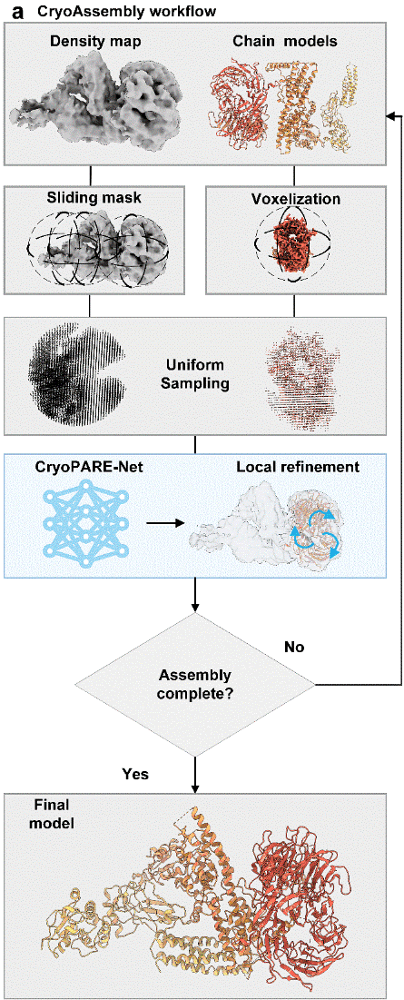

<div align="center">

# CryoAssembly

**通过几何对应学习，从 cryo-EM 和 cryo-ET 密度图中装配蛋白结构**


[](LICENSE)

[**打开 CryoAssembly 在线服务器 ↗**](http://zhouxglab.com/CryoAssembly/)

[English](README.md) · **简体中文**

[在线服务器](#web-server) · [安装](#installation) · [使用](#usage) · [方法](#method) · [常见问题](#faq) · [引用](#citation) · [许可](#license)

</div>

## 概述

CryoAssembly 将输入的蛋白结构拟合并装配到冷冻电镜（cryo-EM）和冷冻电子断层成像（cryo-ET）密度图中。它结合基于深度特征的结构与密度图配准，以及链和域两个层级的装配，输出 mmCIF 格式的蛋白复合物模型。

核心模块 **CryoPARE-Net** 学习结构点云与密度图点云之间的几何对应关系，估计拟合姿态；随后通过密度引导的局部优化和域级装配，将输入组分放置到密度图中。输入结构可以来自结构预测或实验。

| 输入 | 输出 |
| :--- | :--- |
| 密度图、蛋白结构模型、分辨率和轮廓阈值 | 装配后的复合物模型（`.cif`）与装配摘要 |

<details open>
<summary><strong>查看方法流程图</strong></summary>

<p align="center">
  
</p>

**总体流程。** 点云准备、CryoPARE-Net 拟合、局部优化和分层装配（正文 Fig. 1a）。

</details>

<a id="web-server"></a>

## 在线服务器

通过 [**CryoAssembly 在线服务器**](http://zhouxglab.com/CryoAssembly/) 在浏览器中提交密度图和蛋白结构，或按下面的[安装流程](#installation)在本地运行。

<a id="installation"></a>

## 安装

需要 **Linux x86_64**、NVIDIA GPU、Conda 和兼容的 C/C++ 编译器。已验证的安装基线为 Ubuntu 20.04、GCC/G++ 9.4 和 CUDA 11.3。

```bash
git clone --branch main --single-branch https://github.com/zhouBiolab/CryoAssembly.git
cd CryoAssembly
bash install.sh
conda activate cryoassembly
```

安装脚本创建独立的 `cryoassembly` 环境，安装固定版本的依赖，并编译仓库附带的 `pareconv` 与 `pointops` 扩展。`requirements.txt` 是唯一的 Python 依赖定义。

<details>
<summary><strong>系统要求与已验证环境</strong></summary>

安装需要兼容 CUDA 11.3 的 NVIDIA 驱动、编译工具、`libGL.so.1` 和 `libgomp.so.1`。在 Ubuntu 20.04 中，运行脚本前可以用以下命令补齐缺少的系统包：

```bash
sudo apt-get install build-essential libgl1 libgomp1
```

| 组件 | 已验证基线 |
| :--- | :--- |
| 操作系统 | Ubuntu 20.04.6，Linux x86_64 |
| 编译器 | GCC/G++ 9.4.0 |
| Python | 3.8.20 |
| PyTorch | 1.10.0+cu113 |
| CUDA 工具链 / nvcc | 11.3.1 / 11.3.122 |
| NumPy / Numba / llvmlite | 1.21.5 / 0.56.4 / 0.39.1 |
| SciPy / Biopython / Open3D | 1.10.1 / 1.79 / 0.14.1 |

脚本从官方 cu113 索引获取 PyTorch，并核对依赖版本、扩展和导入情况。

</details>

<details>
<summary><strong>环境选择与安装核验</strong></summary>

```bash
bash install.sh myenv                  # 创建新环境
bash install.sh myenv --skip-env       # 在已有环境中安装依赖并重新编译
bash install.sh myenv --verify-only    # 仅核验已有安装，不安装或编译
bash install.sh --help
```

使用新环境名，或对已有 Python 3.8.20 和 CUDA 11.3 工具链的环境选择 `--skip-env`。`--verify-only` 核验依赖、导入和算子。

`CONDA_BASE` 选择 Conda 安装位置，`MAX_JOBS` 设置编译进程数，默认为 8。`PIP_INDEX_URL` 和 `PIP_FIND_LINKS` 指定 Python 包镜像或 wheel 缓存。

</details>

<a id="usage"></a>

## 使用

### 准备输入

创建目录并放入密度图及蛋白结构：

```text
data_dir/
├── map.mrc
├── model_A.pdb
├── model_B.cif
├── resolution.txt
└── contour_level.txt
```

`resolution.txt` 包含以 Å 为单位的分辨率；`contour_level.txt` 包含密度图轮廓阈值。链标识从结构文件内容读取。

### 运行装配

在仓库目录中激活 `cryoassembly` 后运行：

```bash
python main.py data_dir --log
```

保持域拆分开启。**如果结构文件包含多条链，需要添加 `--complex-domain-opt`。**

### 查看结果

默认输出目录位于输入密度图旁。主要结果文件为：

```text
data_dir/output/assembly/final_results/
├── assembled_complex.cif
├── assembled_complex_all.cif
├── refined_complex.cif          # 精修产生结果时存在
└── assembly_summary.txt
```

`assembled_complex.cif` 为过滤后的装配模型，`assembled_complex_all.cif` 包含全部已接受组分；精修产生结果时，保存为 `refined_complex.cif`。

<details>
<summary><strong>手动指定输入与输出目录</strong></summary>

手动模式支持 `.mrc` 和 `.map`；自动目录模式只发现 `.mrc`。依次指定密度图、结构目录、分辨率、轮廓阈值和可选输出目录：

```bash
python main.py data_dir/map.mrc data_dir 5.6 0.04 result --log
```

将 `5.6` 和 `0.04` 替换为对应密度图的分辨率和轮廓阈值。结果位于 `result/assembly/final_results/`。

</details>

<details>
<summary><strong>多链输入与精修选项</strong></summary>

处理包含多条链的结构模板：

```bash
python main.py data_dir --complex-domain-opt --log
```

同源域精修默认开启。添加 `--homo-chain-refine` 可以开启其后的可选同源链精修阶段：

```bash
python main.py data_dir --complex-domain-opt --homo-chain-refine --log
```

使用 `--no-refine` 关闭同源域精修。

</details>

<details>
<summary><strong>参数与显存控制</strong></summary>

| 选项 | 默认值 | 含义 |
| :--- | :---: | :--- |
| `--chain-threshold` | 0.45 | 链拟合早停与预筛阈值 |
| `--domain-threshold` | 0.45 | 独立域拟合的初始阈值 |
| `--complex-threshold` | 0.35 | 多链模板整体拟合的早停与预筛阈值 |
| `--domain-min-cc` | 0.35 | 域拟合阈值的调整下限 |
| `--complex-min-cc` | 0.25 | 最终域级输出过滤阈值 |
| `--num-processes` | 8 | 评分与局部优化共用的 CPU 进程池大小 |
| `--batch-size` | 5 | 每批累积评估的候选数 |
| `--mask-radius-factor` | 1.35 | 掩码半径相对于源结构回转半径的倍数；减小可降低单次拟合显存占用，但会增加拟合次数 |
| `--min-point-distance-factor` | 0.32 | 掩码中心间距相对于掩码半径的系数 |
| `--hypothesis-chunk` | 64 | 每块评分的位姿假设数，用于限制推理显存 |

位姿假设分块的有效默认值为 64。显式 CLI 值优先于 `--runtime-config`；设为 `0` 会关闭假设分块，保留查询分块。

使用 `python main.py --help` 查看完整选项，详细拟合和装配行为见 [ALGORITHM.md](ALGORITHM.md)。

</details>

<a id="method"></a>

## 方法

1. **生成结构与密度图点云。** 通过体素化、采样和滑动密度掩码，准备局部结构与密度图配准输入。
2. **使用 CryoPARE-Net 估计拟合姿态。** 学习几何特征以建立对应关系并估计刚体姿态，随后进行密度引导的局部优化。
3. **通过链和域完成分层装配。** 链级拟合为域处理提供候选姿态，剩余域独立拟合；接受域时掩蔽其占据的密度区域。
4. **合并与精修。** 将已接受的域合并成链和复合物；同源域姿态重分配利用连接信息，随后通过输出过滤和可选精修生成最终模型。

完整算法说明见 [ALGORITHM.md](ALGORITHM.md)。

<a id="faq"></a>

## 常见问题

<details>
<summary><strong>如何选择轮廓阈值？</strong></summary>

从密度图的推荐轮廓阈值开始，结合观察调整保留的密度范围。该值控制目标点云的采样区域。

</details>

<details>
<summary><strong>GPU 显存不足时怎么办？</strong></summary>

减小 `--mask-radius-factor` 以使用更小的密度区域，或减小正整数 `--hypothesis-chunk` 以减少每次评分的位姿假设数。`--num-processes` 控制 CPU 进程数。

</details>

<a id="citation"></a>

## 引用

对应正文题目：**Accurate protein structure assembly from cryo-EM and cryo-ET maps through geometric correspondence learning**。

<a id="license"></a>

## 许可

CryoAssembly 的原创贡献采用 **LGPL-3.0-only**。完整条款见 [LICENSE](LICENSE)、其纳入的 [GPL 第 3 版条款](licenses/GPL-3.0.txt)及[第三方声明](THIRD_PARTY_NOTICES.md)。

## 致谢

感谢 [PARE-Net](https://github.com/yaorz97/PARENet) 和 [GeoTransformer](https://github.com/qinzheng93/GeoTransformer) 的作者，为 CryoPARE-Net 提供配准框架与相关组件。

组装流程还使用 **US-align** 进行结构比对、[**CryoAlign**](https://github.com/HeracleBT/CryoAlign) 的 `Sample` 工具进行点云采样、**DomainParser** 进行域划分、**DSSP** 进行二级结构识别。感谢这些工具的开发者。
